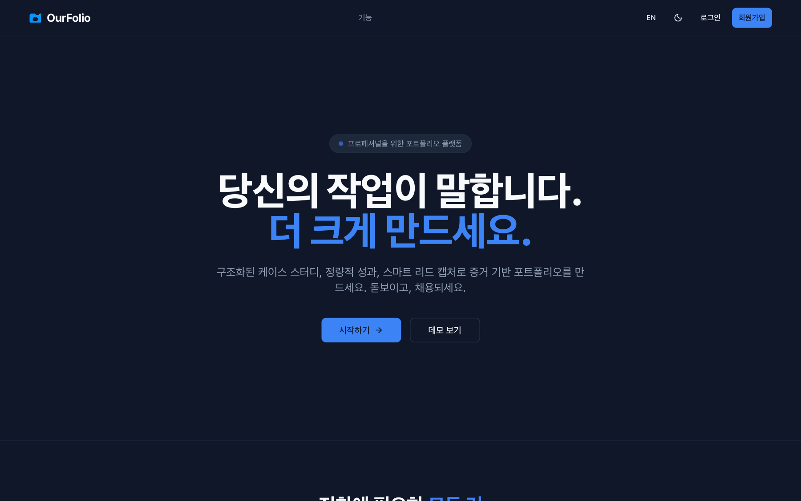
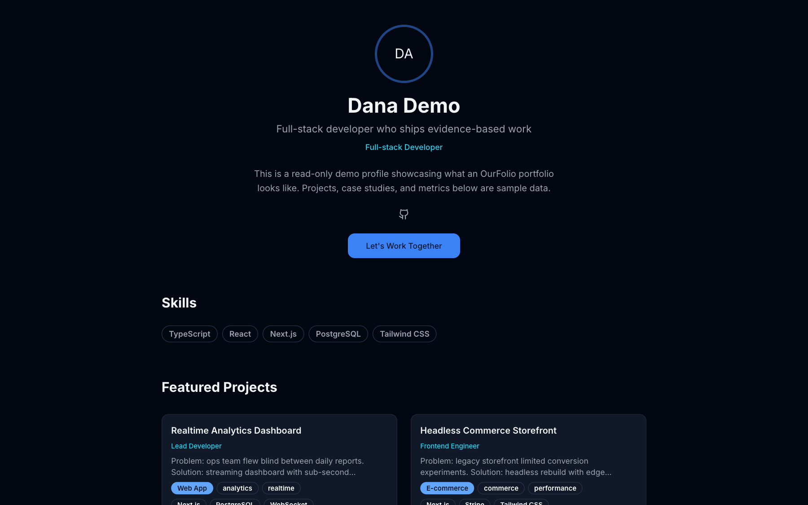

# Ourfolio

증거 기반 포트폴리오 빌더. 프로필과 프로젝트를 등록하면 `/{username}` 공개 페이지로 전시되고, 방문자 리드 수집과 조회 애널리틱스를 제공합니다.

- **라이브 데모**: <https://ourfolio.bkan.dev/demo> - 읽기 전용 `demo` 프로필(시드 데이터, 실계정 아님)
- **소스 코드**: <https://github.com/Bkankim/project-ourfolio>

> 이 리포는 수익화 SaaS가 아닌 포트폴리오 전시(showcase) 용도로 운영됩니다.

## 스크린샷

| 랜딩 | 공개 데모 프로필 |
| --- | --- |
|  |  |

## 아키텍처

| 레이어 | 기술 |
| --- | --- |
| 프레임워크 | Next.js 16 (App Router, React 19) |
| 데이터베이스 | Neon (serverless Postgres) + drizzle-orm / drizzle-kit |
| 인증 | BetterAuth - Google · GitHub OAuth |
| 파일 스토리지 | Cloudflare R2 (S3 호환 API, 공개 `*.r2.dev` URL) |
| 이메일 | Resend |
| 에러 트래킹 | Sentry (`@sentry/nextjs`) |
| 배포 | Vercel (region: icn1) |

## 기능

- **프로필 / 프로젝트**: 공개 포트폴리오 페이지(`/{username}`), 프로젝트 상세, OG 이미지 동적 생성
- **리드 수집**: 방문자 문의 폼 → `leads` 테이블 + Resend 이메일 알림
- **애널리틱스**: 페이지 뷰·이벤트 자체 수집(`analytics_events`) + 대시보드 통계
- **GitHub repo import**: GitHub OAuth 연동으로 저장소 메타데이터를 프로젝트로 가져오기
- **이미지 업로드/크롭**: react-easy-crop → R2 presigned 업로드
- **i18n**: ko / en 로케일 (키 대칭을 테스트로 강제 - `tests/i18n.test.ts`)
- **동의 관리(consents)**: 약관·개인정보 동의 이력 저장, `policyVersion` 버저닝

## 기술적 근거 (하이라이트)

- **Expand–contract 마이그레이션**: 스키마 v1 전환을 `drizzle/0002_v1_expand.sql` → `0003_v1_contract.sql` 2단계로 분리해 무중단 배포와 호환성을 확보
- **동의 버저닝**: `consents.policyVersion`으로 정책 개정 시 재동의 추적 가능
- **Sentry PII 스크러빙**: `src/lib/sentry-scrub.ts`에서 이메일·토큰 등 민감 정보를 이벤트 전송 전 제거 (`tests/sentry-scrub.test.ts`)

## 로컬 실행

```bash
cp .env.example .env.local   # 값 채우기 (Neon DATABASE_URL 등)
pnpm install
pnpm db:migrate
pnpm db:seed                 # 읽기 전용 demo 프로필 + 예시 프로젝트 시드
pnpm dev
```

<http://localhost:3000> 접속. 시드 후 <http://localhost:3000/demo> 에서 데모 포트폴리오를 확인할 수 있습니다.

시드 스크립트(`scripts/seed-demo.ts`)는 멱등(idempotent)하며, 프로덕션 호스트(DATABASE_URL이 neon.tech 등 non-localhost)에서는 `SEED_ALLOW_PROD` 없이 실행되지 않습니다.

`.env.example`에 없는 키도 코드가 씁니다.<br>
R2 접근 키(`R2_ACCESS_KEY_ID`, `R2_SECRET_ACCESS_KEY`)와 서버 Sentry DSN(`SENTRY_DSN`)입니다.<br>
`.envrc`가 direnv로 상위 폴더의 `.env`를 먼저 읽고 `.env.local`로 덮어쓰는 구조라서, direnv를 쓰지 않으면 이 키들을 `.env.local`에 직접 넣어야 합니다.

## 검증

```bash
pnpm typecheck && pnpm lint && pnpm test && pnpm build
```

2026-11-13 기준 네 명령 모두 통과합니다(시험 5개 파일 42건, lint는 오류 0건과 경고 8건).

## 배포와 CI

- 프로덕션은 Vercel(region `icn1`)이 이 리포(`Bkankim/project-ourfolio`)의 `master`를 빌드합니다.<br>
  보안 헤더(`X-Frame-Options` 등)는 `vercel.json`에 있습니다.
- `master` push와 PR마다 `quality.yml`(typecheck, lint, test, build), `coverage.yml`, `lighthouse.yml`이 돕니다.
- PR에서는 `preview.yml`이 Vercel preview를 올리고 주소를 댓글로 답니다(dependabot PR은 제외).
- `src/db/schema.ts`나 `drizzle/`을 바꾼 PR은 `db-migration-check.yml`이 스키마와 마이그레이션이 어긋났는지 봅니다.<br>
  스키마를 바꾸면 `pnpm db:generate`로 마이그레이션을 만들어 같이 커밋합니다.
- `package.json`이나 `pnpm-lock.yaml`을 바꾼 PR은 `dependency-audit.yml`이 `pnpm audit --prod --audit-level=high`를 돌립니다.
- 시크릿 값은 리포에 두지 않습니다.<br>
  GitHub Actions 시크릿 이름은 `VERCEL_TOKEN`, `VERCEL_ORG_ID`, `VERCEL_PROJECT_ID`, `CODECOV_TOKEN`(선택)입니다.

## 결정과 절충

- **원본 리포를 하나로 합쳤습니다(2026-11-08).** 예전에는 조직 리포(`bkan-hq/project-ourfolio`)를 원본으로 두고 이 리포로 force push 미러링해 배포했습니다.<br>
  Vercel이 이미 이 리포를 빌드하고 있어서 미러 단계를 지웠습니다(`db92d6b`).<br>
  그래서 조직 리포에 push해도 배포되지 않습니다.
- **간접 의존성 보안 패치는 `pnpm-workspace.yaml`의 `overrides` 한 곳에 둡니다(2026-11-08, `7f53a23`).** `package.json`에도 같이 두는 안은 두 곳이 어긋나기 쉬워 버렸습니다.<br>
  CI는 pnpm 10을 씁니다.<br>
  pnpm 9는 workspace yaml의 `overrides`를 읽지 못하고, 로컬의 더 새 pnpm은 CI보다 audit 결과가 적게 나올 수 있어서, 의존성을 고친 뒤 audit은 pnpm 10으로 다시 봅니다.
- **보안 패치 버전은 최신이 아니라 배포된 지 2주가 지난 패치 버전 중 가장 낮은 것으로 고정했습니다(2026-11-08).**<br>
  갓 나온 버전의 공급망 위험을 피하려는 것이고, 그 대신 더 최근 수정은 받지 못합니다.
- **랜딩 첫 화면은 슬로건보다 서비스 정체를 먼저 말합니다(2026-09-12, `305a7a3`).**<br>
  슬로건만 있는 첫 화면은 무엇을 하는 서비스인지 읽히지 않아, 첫 문구에 "포트폴리오 빌더"를 넣고 슬로건은 아래 섹션 제목으로 내렸습니다.

## 한계와 다음

- 포트폴리오 전시용이라 결제 기능이 없습니다.
- Next.js 16 빌드가 `src/middleware.ts`에 "middleware 파일 규약은 폐기 예정이니 proxy를 쓰라"는 경고를 냅니다(2026-11-13 빌드).<br>
  지금은 동작하지만 `proxy`로 옮길 일이 남아 있습니다.
- lint 경고 8건이 남아 있습니다(2026-11-13).<br>
  내부 이동에 `window.location.href`를 쓰는 곳 3건, `next/image` 대신 ``를 쓰는 곳 3건, `useEffect` 의존성 누락 1건, 쓰지 않는 변수 1건입니다.

## 데모 계정 안내

`/demo`는 시드된 읽기 전용 프로필입니다. 로그인 가능한 실계정이 아니며, 대시보드 기능은 OAuth 로그인 후 본인 계정으로 확인할 수 있습니다.
